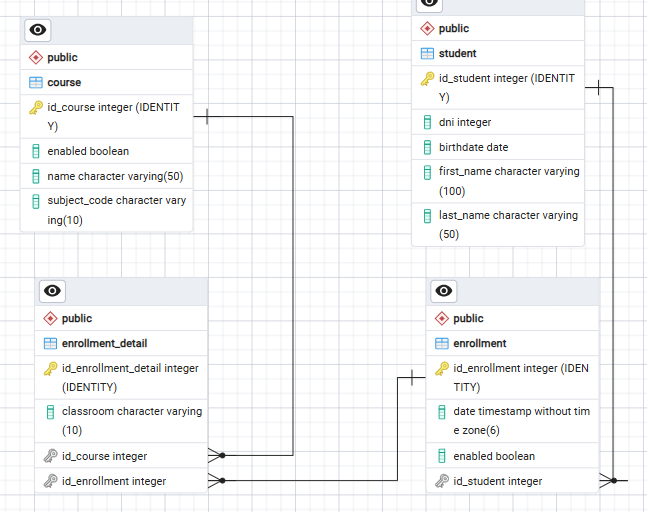

# Students Academic

API REST para gestionar alumnos, cursos e inscripciones de un centro académico. Permite dar de alta alumnos y cursos, inscribir alumnos en matrículas (`Enrollment`) y asignar cada matrícula a cursos concretos mediante detalles de matrícula (`EnrollmentDetail`), además de consultar la composición de cada curso con sus alumnos en una sola llamada.

## Tecnologías

- Java 25
- Spring Boot 4.1.2 (Spring MVC, Spring Data JPA, Bean Validation)
- PostgreSQL
- Lombok
- ModelMapper 3.2.6 (conversión entidad ↔ DTO)
- Maven (con wrapper `mvnw` / `mvnw.cmd`)

## Modelo de datos



| Entidad | Tabla | Descripción |
|---|---|---|
| `Student` | `student` | Alumno: nombre, apellido, DNI y fecha de nacimiento. |
| `Course` | `course` | Curso: nombre, código de asignatura y flag `enabled`. |
| `Enrollment` | `enrollment` | Matrícula de un alumno (`student`), con fecha y flag `enabled`. |
| `EnrollmentDetail` | `enrollment_detail` | Línea de una matrícula: aula (`classroom`), `enrollment` y `course`. |

Relaciones:

- Un `Enrollment` pertenece a un `Student` (`id_student`, NOT NULL).
- Un `EnrollmentDetail` pertenece a un `Enrollment` (`id_enrollment`, NOT NULL) y a un `Course` (`id_course`, NOT NULL).

## Requisitos previos

- JDK 25
- PostgreSQL en ejecución, con una base de datos creada (por defecto `db_students_academic`).

## Configuración

La conexión a la base de datos se configura mediante variables de entorno. Si no se definen, se usan los valores por defecto de `src/main/resources/application.yaml`:

| Variable | Valor por defecto                                       | Descripción |
|---|---------------------------------------------------------|---|
| `DB_URL` | `jdbc:postgresql://localhost:5432/db_students_academic` | URL JDBC de la base de datos. |
| `DB_USERNAME` | `postgres`                                              | Usuario de la base de datos. |
| `DB_PASSWORD` | `pass123`                                               | Contraseña de la base de datos. |

> Se recomienda definir `DB_PASSWORD` en el entorno en lugar de usar el valor por defecto.

El esquema se crea y actualiza automáticamente al arrancar (`spring.jpa.hibernate.ddl-auto: update`).

## Puesta en marcha

Con el wrapper de Maven (en Windows usar `mvnw.cmd` en lugar de `./mvnw`):

```bash
# Compilar
./mvnw compile

# Ejecutar tests
./mvnw test

# Arrancar la aplicación (puerto por defecto 8080)
./mvnw spring-boot:run
```

Alternativamente, generar el jar y ejecutarlo:

```bash
./mvnw clean package
java -jar target/students-academic-0.0.1-SNAPSHOT.jar
```

## Endpoints

Base URL: `http://localhost:8080`

| Método | Ruta | Descripción | Respuesta |
|---|---|---|---|
| `GET` | `/v1/students` | Lista todos los alumnos. | `200` |
| `GET` | `/v1/students/{id}` | Obtiene un alumno por id. | `200` / `404` |
| `POST` | `/v1/students` | Crea un alumno. | `201` |
| `PUT` | `/v1/students/{id}` | Actualiza un alumno. | `200` |
| `DELETE` | `/v1/students/{id}` | Elimina un alumno. | `204` |
| `GET` | `/v1/courses` | Lista todos los cursos. | `200` |
| `GET` | `/v1/courses/{id}` | Obtiene un curso por id. | `200` / `404` |
| `GET` | `/v1/courses/students` | Lista **todos** los cursos (incluidos los deshabilitados) con los alumnos inscritos en cada uno. Cada alumno aparece una vez por curso; los cursos sin alumnos devuelven `students: []`. | `200` |
| `POST` | `/v1/courses` | Crea un curso. | `201` |
| `PUT` | `/v1/courses/{id}` | Actualiza un curso. | `200` |
| `DELETE` | `/v1/courses/{id}` | Elimina un curso. | `204` |
| `GET` | `/v1/enrollments` | Lista todas las matrículas. | `200` |
| `GET` | `/v1/enrollments/{id}` | Obtiene una matrícula por id. | `200` / `404` |
| `POST` | `/v1/enrollments` | Crea una matrícula. | `201` |
| `PUT` | `/v1/enrollments/{id}` | Actualiza una matrícula. | `200` |
| `DELETE` | `/v1/enrollments/{id}` | Elimina una matrícula. | `204` |
| `GET` | `/v1/enrollment-details` | Lista todos los detalles de matrícula. | `200` |
| `GET` | `/v1/enrollment-details/{id}` | Obtiene un detalle de matrícula por id. | `200` / `404` |
| `POST` | `/v1/enrollment-details` | Crea un detalle de matrícula. | `201` |
| `PUT` | `/v1/enrollment-details/{id}` | Actualiza un detalle de matrícula. | `200` |
| `DELETE` | `/v1/enrollment-details/{id}` | Elimina un detalle de matrícula. | `204` |

### Ejemplos

Crear un curso:

```http
POST /v1/courses
Content-Type: application/json

{
  "name": "Matemáticas",
  "subjectCode": "MAT1",
  "enabled": true
}
```

Crear un detalle de matrícula asociado a un curso:

```http
POST /v1/enrollment-details
Content-Type: application/json

{
  "classroom": "A101",
  "enrollment": {
    "date": "2026-10-31T10:00:00",
    "enabled": true,
    "student": { "idStudent": 1 }
  },
  "course": { "idCourse": 1 }
}
```

Consultar los cursos con sus alumnos:

```http
GET /v1/courses/students
```

```json
[
  {
    "idCourse": 1,
    "name": "Matemáticas",
    "subjectCode": "MAT1",
    "enabled": true,
    "students": [
      { "idStudent": 1, "firstName": "Ana", "lastName": "Pérez", "dni": 123, "birthdate": "2000-01-01" }
    ]
  },
  {
    "idCourse": 2,
    "name": "Física",
    "subjectCode": "FIS1",
    "enabled": false,
    "students": []
  }
]
```

### Errores

Todas las respuestas de error tienen el formato:

```json
{
  "timestamp": "2026-10-31T10:00:00",
  "message": "ID NOT FOUND: 99",
  "path": "uri=/v1/courses/99"
}
```

| Código | Cuándo |
|---|---|
| `400 Bad Request` | Falla la validación del cuerpo de la petición (`@Valid`). |
| `404 Not Found` | No existe el recurso solicitado (`ModelNotFoundException`). |
| `406 Not Acceptable` | Errores aritméticos o de formato numérico. |
| `500 Internal Server Error` | Cualquier otra excepción no controlada. |

## Estructura del proyecto

```
src/main/java/com/proyect/
├── config/       # Configuración: ModelMapper, manejo global de errores
├── controller/   # Controladores REST (/v1/...)
├── dto/          # DTOs de entrada/salida con validaciones
├── model/        # Entidades JPA
├── repo/         # Repositorios Spring Data JPA
└── service/      # Interfaces de servicio
    └── Impl/     # Implementaciones (CRUDImpl genérico + servicios concretos)
```

La capa de servicio se apoya en `CRUDImpl<T, ID>`, que implementa las operaciones CRUD comunes. Los servicios concretos sólo indican el repositorio que usan, salvo `CourseServiceImpl`, que añade `findAllWithStudents()`.

La consulta de `/v1/courses/students` se resuelve con una única consulta JPQL con `JOIN FETCH` (en `IEnrollmentDetailRepo`), y la agrupación por curso se hace en el servicio, evitando el problema N+1.

## Tests

Actualmente sólo existe un test de arranque del contexto (`StudentsAcademicApplicationTests`). Requiere una base de datos PostgreSQL accesible con la configuración indicada.

## Estado

El endpoint `GET /v1/courses/students` está implementado y compila (`./mvnw compile`). Todavía no se ha probado contra una base de datos real.

Al añadir la relación `EnrollmentDetail → Course` a una base de datos que ya tenga filas en `enrollment_detail`, PostgreSQL rechaza la columna `id_course` por ser NOT NULL. En ese caso hay que vaciar la tabla o rellenar la columna antes de arrancar la aplicación.
